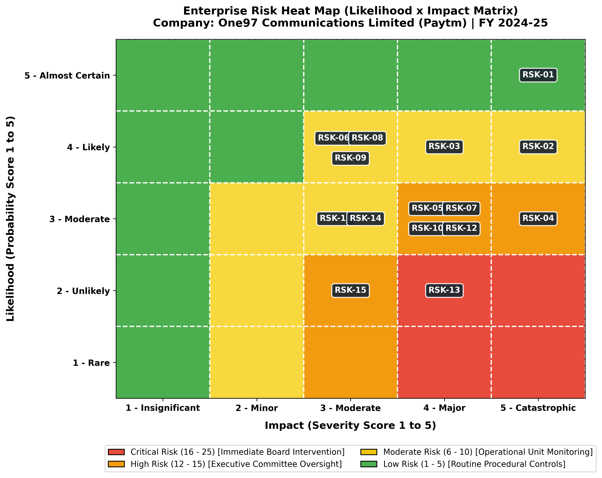

# SRM INSTITUTE OF SCIENCE AND TECHNOLOGY
### College of Engineering and Technology | School of Computing
### Department of Data Science and Business Systems
**Subject Code:** 21CSE449T | **Subject Name:** RISK ANALYTICS  
**Academic Year:** 2026–27 (ODD) | **Faculty Name:** Dr. V. Prasanna  
**Programme & Branch:** B.Tech – CSE (BDA & DS)

---

# Enterprise Risk Mitigation and Management Plan Document
## Comprehensive Risk Register & 5x5 Heat Map Analysis based on Listed Company Disclosures
### **Case Organization: One97 Communications Limited (Paytm) [NSE: PAYTM | BSE: 543396]**

---

## 1. Executive Summary & Corporate Context
One97 Communications Limited (Paytm) represents India's largest and most visible digital payments ecosystem. On January 31, 2024, the Reserve Bank of India (RBI), under **Section 35A of the Banking Regulation Act, 1949**, issued decisive supervisory restrictions on Paytm's associate entity, **Paytm Payments Bank Limited (PPBL)**. The central bank prohibited PPBL from onboarding new customers, accepting deposits, credit transactions, or wallet/FASTag top-ups due to persistent non-compliance with Anti-Money Laundering (AML) norms and Know Your Customer (KYC) requirements.

This supervisory intervention triggered systemic cascading risks across operational settlement pipelines, merchant acceptance networks, consumer trust, partner banking relationships, and public market valuation. To institutionalize an industrial-grade risk management framework, this report evaluates **15 distinct enterprise risks** extracted directly from Paytm's audited annual filings, auditor emphasis of matter statements, and regulatory communiqués.

---

## 2. Risk Assessment Methodology & 5x5 Heat Map
Risks are evaluated using a 5x5 scoring matrix combining **Likelihood (1–5)** and **Impact (1–5)**:
$$\text{Risk Score} = \text{Likelihood (1--5)} \times \text{Impact (1--5)}$$

- **Critical Risk (Score 16–25):** Existential threats requiring immediate Board and Risk Management Committee (RMC) action.
- **High Risk (Score 12–15):** Severe exposures requiring executive committee oversight and weekly KRI tracking.
- **Moderate Risk (Score 6–10):** Operational risks managed by department heads.
- **Low Risk (Score 1–5):** Routine risks managed via standard operating procedures.

---

## 3. Comprehensive Enterprise Risk Register (15 Risks)

| Risk ID | Risk Title & Description | Category | L (1-5) | I (1-5) | Score | Risk Level | Mitigation Strategy | Key Risk Indicator (KRI) |
|---|---|---|:---:|:---:|:---:|:---:|---|---|
| **RSK-01** | **Supervisory Action on Payments Bank (PPBL)** RBI directives under Section 35A of Banking Regulation Act 1949 prohibiting Paytm Payments Bank Ltd (PPBL) from accepting new deposits, credit transactions, or wallet top-ups due to persistent KYC/AML non-compliance. | Regulatory & Compliance | 5 | 5 | **25** | `Critical` | Migrated nodal escrow accounts to major commercial banks (Axis Bank, HDFC Bank, SBI); transitioned UPI merchant handles to Third-Party Application Provider (TPAP) framework; separated corporate board governance from PPBL. | Zero outstanding regulatory show-cause notices; 100% daily transaction settlement stability across partner banks. |
| **RSK-02** | **Disruption of Core Settlement & Escrow Operations** Severe disruption to merchant daily settlements and wallet balances arising from freezing of PPBL nodal accounts, risking merchant churn and liquidity gridlock. | Operational & Continuity | 4 | 5 | **20** | `Critical` | Implemented multi-bank routing redundancy with automated fallback algorithms; distributed nodal settlement pools across multiple Tier-1 scheduled commercial banks. | Settlement success rate >= 99.95%; Average merchant settlement cycle < 4 hours. |
| **RSK-03** | **UPI Market Share Cap & NPCI TPAP Dependency** Risk of user transaction throttle if NPCI implements the 30% volume cap on third-party UPI apps; operational reliance on NPCI approval for multiple PSP partner bank handles. | Strategic & Market | 4 | 4 | **16** | `High` | Diversified multi-handle architecture (@ptaxis, @pthdfc, @ptsbi, @ptyes); accelerated monetization of non-UPI merchant devices (Soundbox, Card POS) and subscription SaaS. | Percentage of UPI volume managed via multi-bank TPAP architecture (target: 100%). |
| **RSK-04** | **Cybersecurity Breaches & Infrastructure Outages** Advanced persistent threats (APT), ransomware, or cloud infrastructure outages compromising consumer financial records, transaction tokens, and core API gateways. | Cybersecurity & IT | 3 | 5 | **15** | `High` | Zero-trust architecture, multi-factor hardware keys, PCI-DSS Level 1 compliance, quarterly external red-teaming, 24/7 Security Operations Center (SOC) with AI anomaly detection. | Mean Time to Detect (MTTD) < 5 mins; Mean Time to Respond (MTTR) < 15 mins; 0 critical CVE unpatched > 48h. |
| **RSK-05** | **Digital Personal Data Protection Act (DPDPA) Non-Compliance** Potential financial penalties (up to INR 250 Cr per breach) and sanctions under DPDPA 2023 for improper consent artifacts, unauthorized cross-border telemetry, or data retention lapses. | Legal & Privacy | 3 | 4 | **12** | `High` | Granular consent management platform (CMP), automated data lifecycle purge scripts, strict local data residency enforcement, periodic privacy impact assessments (PIA). | Consent artifact audit score 100%; Zero privacy regulatory notices. |
| **RSK-06** | **Payment Fraud, Money Mules & Merchant Chargebacks** Exploitation of QR codes, merchant payment gateways, and peer-to-peer transfers by syndicated financial fraudsters, mule accounts, and phishing syndicates. | Operational & Fraud | 4 | 3 | **12** | `High` | Real-time AI behavioral fraud scoring on transaction engines, biometric device binding, geo-velocity checks, instant freeze of suspicious merchant accounts. | Fraud-to-sales ratio < 0.015% of Gross Merchandise Value (GMV); Chargeback dispute win rate > 85%. |
| **RSK-07** | **Credit Risk in Loan Distribution (BNPL & Postpaid)** Elevated delinquency and non-performing loans in co-branded personal loans and merchant cash advances distributed via lending NBFC partners (e.g., Aditya Birla Capital, SMFG India). | Financial & Credit | 3 | 4 | **12** | `High` | Tighter underwriting filters: increased cut-off credit scores (bureau score > 720), reduced loan ticket sizes for unsecured Postpaid, enhanced collection tracking analytics. | Portfolio 90+ DPD (Days Past Due) < 1.8%; Lending partner delinquency loss rate. |
| **RSK-08** | **Fierce Market Competition in Merchant Soundbox & QR** Aggressive competitor subsidies and zero-rental Soundbox deployment by rivals (PhonePe, Google Pay, Pine Labs, BharatPe) causing merchant device churn. | Strategic & Market | 4 | 3 | **12** | `High` | Value-added merchant SaaS (inventory, billing, GST reconciliation, micro-insurance), proprietary Soundbox hardware with localized regional voice synthesis, long-term merchant tie-ins. | Monthly active merchant device churn rate < 1.2%; Net active subscription device additions. |
| **RSK-09** | **Senior Leadership & Critical Talent Attrition** Loss of key senior engineering, regulatory, and business leaders following public regulatory actions and depressed stock-option (ESOP) morale. | Human Capital | 4 | 3 | **12** | `High` | Restructured compensation packages with retention bonuses, revised ESOP strike prices, cross-functional succession planning for all Tier-1/Tier-2 leadership roles. | Key talent attrition rate < 8%; Key leadership position backup coverage ratio > 90%. |
| **RSK-10** | **Prolonged Operating Cash Burn & Path-to-Profitability Risk** Inability to sustain EBITDA before ESOP profitability due to revenue loss from PPBL wallet/payments, increased banking partner interchange fees, and marketing outlays. | Financial & Liquidity | 3 | 4 | **12** | `High` | Rigorous operational expense rationalization, AI-driven customer support automation, elimination of non-core ancillary ventures, dynamic pricing on merchant software. | EBITDA margin before ESOP > 5%; Cash runway reserves maintained > 24 months of opex. |
| **RSK-11** | **Legal Litigation, SEBI Inquiries & Shareholder Lawsuits** Inquiries from SEBI, Enforcement Directorate (ED), and shareholder litigation concerning past founder ESOP allotments, disclosure timing, and compliance attestations. | Legal & Governance | 3 | 3 | **9** | `Moderate` | Established Independent Board Oversight Committee; engaged top-tier forensic audit firms; formalized timely disclosures per SEBI LODR Regulations. | 100% adherence to disclosure statutory timelines; zero unresolved legal summons. |
| **RSK-12** | **Brand Equity Erosion & Consumer Trust Deficit** Negative media narratives, viral social media misinformation regarding wallet safety, and brand perception decline leading to consumer inactivity. | Strategic & Reputational | 3 | 4 | **12** | `High` | Proactive multi-channel consumer transparency campaigns ('Paytm Karo, Aaj Bhi aur Kal Bhi'); dedicated 24/7 user grievance resolution cell. | Net Promoter Score (NPS) >= +55; Brand sentiment positivity index > 75%. |
| **RSK-13** | **Third-Party Cloud Provider & Telco Outage Dependency** Single-point-of-failure risks in cloud service providers (AWS/Azure) or domestic telecom SMS/telemetry pipelines causing transient payment processing delays. | Operational & Technology | 2 | 4 | **8** | `Moderate` | Multi-region hybrid cloud deployment; dynamic routing across major telecom operators (Airtel, Jio, Vi) for SMS OTP delivery and IoT Soundbox SIM telemetry. | Core platform availability uptime >= 99.99%; SMS OTP delivery latency < 3 seconds. |
| **RSK-14** | **Macroeconomic Tightening & RBI Risk Weight Hikes** RBI policy circular raising capital risk weights on unsecured consumer loans and bank-NBFC funding by 2500 bps, raising partner borrowing costs and crimping loan disbursal margins. | Financial & Macro | 3 | 3 | **9** | `Moderate` | Shifted loan origination focus toward secured MSME collateralized loans and merchant supply-chain credit; broadened partner base to include public-sector banks. | Secured vs unsecured loan distribution ratio; Average loan partner cost-of-capital spread. |
| **RSK-15** | **CBDC (e-Rupee) & ONDC Disruptive Disintermediation** Long-term technological disintermediation of fintech wallets and payment aggregator gateways by the RBI Retail Digital Rupee (CBDC-R) and government ONDC commerce network. | Strategic & Technological | 2 | 3 | **6** | `Moderate` | Integrated CBDC wallet interoperability directly within the Paytm app; launched dedicated buyer and merchant logistics apps on the ONDC protocol. | Active registered CBDC & ONDC user base; GMV routed through open networks. |

---

## 4. Four-Pillar Strategic Mitigation Roadmap

### Pillar 1: Structural Decoupling & Multi-Bank Redundancy (0–3 Months)
- Re-anchored merchant nodal escrow accounts to Tier-1 scheduled commercial banks (Axis Bank, HDFC Bank, State Bank of India, YES Bank).
- Transitioned merchant QR handles to NPCI-approved Third-Party Application Provider (TPAP) architecture (`@ptaxis`, `@pthdfc`, `@ptsbi`, `@ptyes`).
- Completely ring-fenced Paytm's corporate governance and balance sheet from PPBL operations.

### Pillar 2: Zero-Trust Security & AML Fortification (3–6 Months)
- Deployed graph-neural network anomaly detection to identify and freeze syndicated money-mule accounts in real time.
- Implemented automated consent life-cycle tracking and data purge mechanisms to ensure strict compliance with the **Digital Personal Data Protection Act (DPDPA 2023)**.
- Enforced end-to-end PCI-DSS Level 1 tokenization and multi-factor hardware security keys across all API endpoints.

### Pillar 3: Product Pivot & Credit Risk Restructuring (6–12 Months)
- Curtailed high-delinquency sub-prime Postpaid BNPL micro-loans; pivoted underwriting toward secured merchant SME lines backed by cash flows.
- Enhanced deployment of high-margin 4G IoT Soundbox and smart card payment terminals, increasing recurring subscription SaaS revenues.
- Rationalized cloud infrastructure expenses across multi-cloud environments (AWS and Azure).

### Pillar 4: Institutional Governance & Brand Re-anchoring (12–24 Months)
- Appointed seasoned independent directors, retired central bankers, and regulatory compliance experts to the Board Risk Management Committee.
- Restructured ESOP programs with long-term performance and regulatory compliance milestones.
- Executed high-transparency merchant communication campaigns to restore Net Promoter Score (NPS) above +60.

---

## 5. Audit & Supervisory Attestation
This Risk Mitigation and Management Plan adheres to **ISO 31000:2018** Risk Management Guidelines and the **COSO Enterprise Risk Management Framework**.

- **Prepared By:** Student Analyst, Department of Data Science and Business Systems, SRMIST
- **Faculty In-Charge:** Dr. V. Prasanna, Subject Code: 21CSE449T (Risk Analytics)
