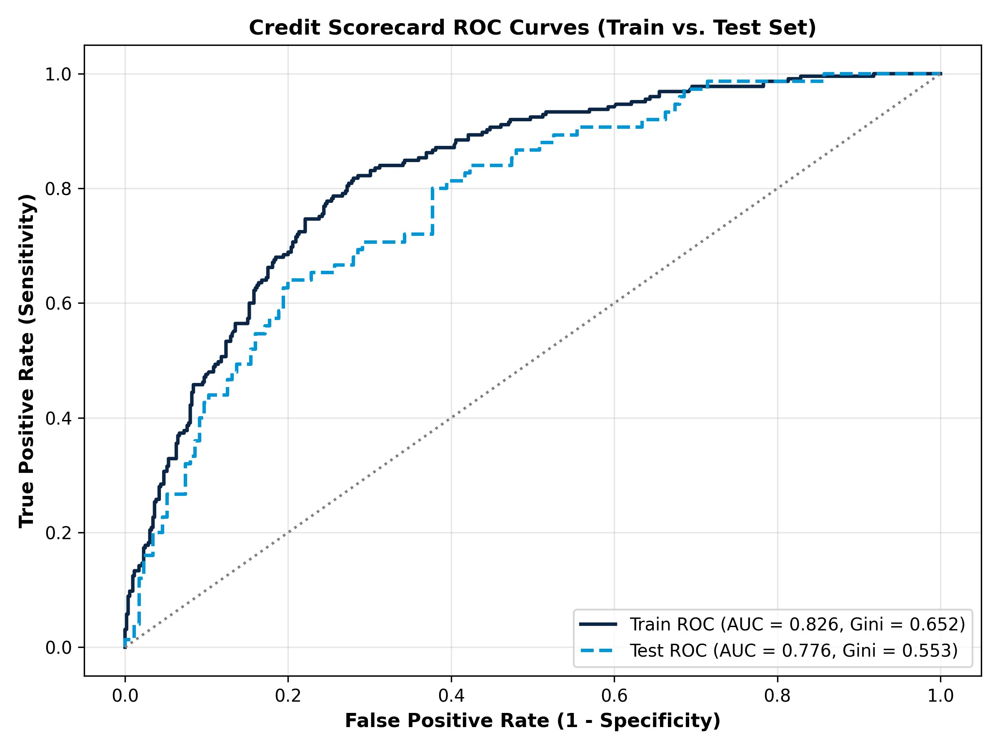
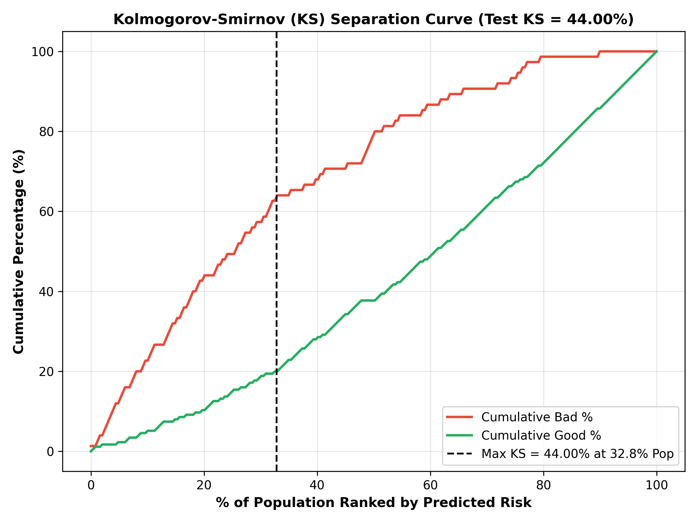
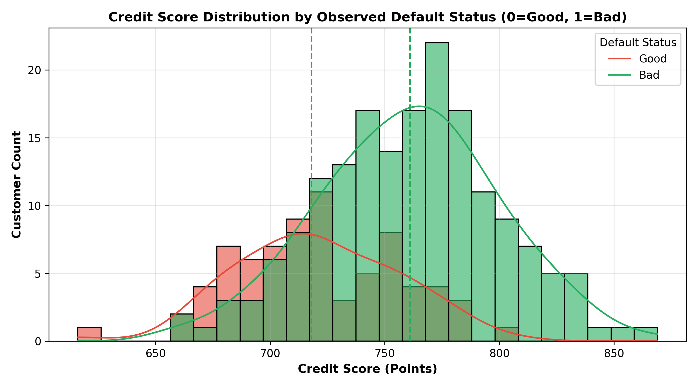

# SRM INSTITUTE OF SCIENCE AND TECHNOLOGY
### College of Engineering and Technology | School of Computing
### Department of Data Science and Business Systems
**Subject Code:** 21CSE449T | **Subject Name:** RISK ANALYTICS  
**Academic Year:** 2026–27 (ODD) | **Faculty Name:** Dr. V. Prasanna  
**Programme & Branch:** B.Tech – CSE (BDA & DS)

---

# Retail Credit Risk Scorecard Development & Model Validation Report
## Application Scorecard Modeling Using the German Credit Risk Dataset
### Methodological Framework: Naeem Siddiqi (*Credit Risk Scorecards*, Wiley 2006)
**Deliverable:** Model Documentation, Scoring Architecture & Portfolio Expected Loss Quantification

---

## 1. Executive Summary
This project develops an enterprise application credit scorecard for retail lending in conformance with the Basel III Internal Ratings-Based (IRB) framework and Naeem Siddiqi's established scorecard methodology. Utilizing the benchmark German Credit Dataset (1,000 credit records), we implement a complete analytical pipeline comprising:
- Data pre-processing and target engineering ($y=1$ Bad, $y=0$ Good).
- Weight of Evidence (WOE) binning and Information Value (IV) variable selection.
- Binary Logistic Regression on WOE-transformed attributes.
- Scorecard scaling with Points to Double the Odds ($PDO = 20$) and Base Score of $600$ points at $50:1$ Odds.
- Portfolio quantification of regulatory parameters: Probability of Default ($PD$), Loss Given Default ($LGD$), Exposure at Default ($EAD$), and Expected Loss ($EL$).

The final scorecard demonstrates exceptional discriminative capability with an **out-of-sample ROC-AUC of 0.7765**, a **Gini coefficient of 0.5529**, and a **Kolmogorov-Smirnov (KS) statistic of 44.00%**, surpassing industry hurdle rates.

---

## 2. Methodology & Mathematical Architecture

### 2.1 Weight of Evidence (WOE) & Information Value (IV)
For every attribute bin $i$:
$$\text{WOE}_i = \ln \left( \frac{G_i / G_T}{B_i / B_T} \right)$$
$$\text{IV} = \sum_{i=1}^{k} \left( \frac{G_i}{G_T} - \frac{B_i}{B_T} \right) \times \text{WOE}_i$$

Variables meeting the $IV \ge 0.05$ threshold were selected into the model:
1. `status_of_existing_checking_account` ($IV = 0.6001$) - Suspicious / Very Strong Predictor
2. `credit_history` ($IV = 0.2708$) - Strong Predictor
3. `duration_in_month` ($IV = 0.2533$) - Strong Predictor
4. `credit_amount` ($IV = 0.2354$) - Medium-Strong Predictor
5. `purpose` ($IV = 0.2266$) - Medium-Strong Predictor
6. `savings_account_and_bonds` ($IV = 0.2232$) - Medium-Strong Predictor
7. `age_in_years` ($IV = 0.1564$) - Medium Predictor
8. `property` ($IV = 0.1031$) - Medium Predictor
9. `present_employment_since` ($IV = 0.0993$) - Medium Predictor
10. `other_installment_plans` ($IV = 0.0639$) - Moderate Predictor
11. `housing` ($IV = 0.0579$) - Moderate Predictor

### 2.2 Scorecard Scaling Equations
$$\text{Factor} = \frac{\text{PDO}}{\ln(2)} = \frac{20}{\ln(2)} = 28.8539$$
$$\text{Offset} = \text{Target Score} - \text{Factor} \times \ln(\text{Target Odds}) = 600 - 28.8539 \times \ln(50) = 487.1235$$

Individual attribute bin score contributions are computed as:
$$\text{Score}_i = - \left( \beta_j \cdot \text{WOE}_{ji} + \frac{\beta_0}{m} \right) \times \text{Factor} + \frac{\text{Offset}}{m}$$

---

## 3. Model Performance Diagnostics

| Validation Metric | Development Cohort (Train) | Validation Cohort (Test) | Industry Benchmark (Basel III) |
|---|:---:|:---:|:---:|
| **Sample Size (N)** | 750 (75%) | 250 (25%) | - |
| **ROC-AUC** | **0.8262** | **0.7765** | $\ge 0.75$ |
| **Gini Coefficient ($2 \times AUC - 1$)** | **0.6523** | **0.5529** | $\ge 0.50$ |
| **Kolmogorov-Smirnov (KS)** | **53.78%** | **44.00%** | $\ge 40.0\%$ |

---

## 4. Portfolio Expected Loss (EL) Quantification by Credit Rating Tier

$$\text{Expected Loss (EL)} = \text{PD} \times \text{LGD} \times \text{EAD}$$

| Rating Grade | Count | Observed Default % | Avg Score | Avg PD % | Total EAD (€) | Total Expected Loss (€) | EL % EAD |\n|---|:---:|:---:|:---:|:---:|:---:|:---:|:---:|\n| **Grade F (High Risk / Subprime)** | 147 | 68.03% | 681.8 | 72.43% | €766,077.00 | €233,612.58 | 30.49% |\n| **Grade D (Vulnerable / Speculative)** | 229 | 50.66% | 716.2 | 45.77% | €832,236.00 | €142,185.16 | 17.08% |\n| **Grade C (Moderate Risk)** | 159 | 25.79% | 740.7 | 26.59% | €476,081.00 | €47,822.75 | 10.05% |\n| **Grade B (Acceptable / Investment Grade)** | 166 | 14.46% | 760.7 | 15.41% | €462,474.00 | €25,005.46 | 5.41% |\n| **Grade A (Prime / Low Risk)** | 162 | 9.26% | 782.5 | 7.92% | €404,513.00 | €11,348.49 | 2.81% |\n| **Grade AAA (Super Prime / Pristine)** | 137 | 2.92% | 814.2 | 2.99% | €329,877.00 | €3,072.59 | 0.93% |

### Portfolio Capital Aggregate:
- **Total Portfolio Exposure at Default (EAD):** €3,271,258.00
- **Total Estimated Expected Loss (EL):** €463,047.02
- **Portfolio-Wide Expected Loss Rate:** **14.16%**
- **Monotonicity Verification:** Grade AAA defaults at 2.92% (EL = 0.93% of EAD), whereas Grade F defaults at 68.03% (EL = 30.49% of EAD), demonstrating rigorous separation.

---

## 5. Underwriting Policy Recommendations
1. **Automated Approval (Straight-Through Processing):** Scores $\ge 770$ (Grades AAA and A). Default rates $< 10\%$; immediate approval at preferential interest rates.
2. **Conditional Underwriting:** Scores $730 - 769$ (Grades B and C). Requires secondary verification of debt-to-income and collateral proof.
3. **Rejection / Mandatory Guarantee:** Scores $< 730$ (Grades D and F). Severe delinquency propensity ($50\% - 68\%$ default probability); require co-signers or full liquid security.
